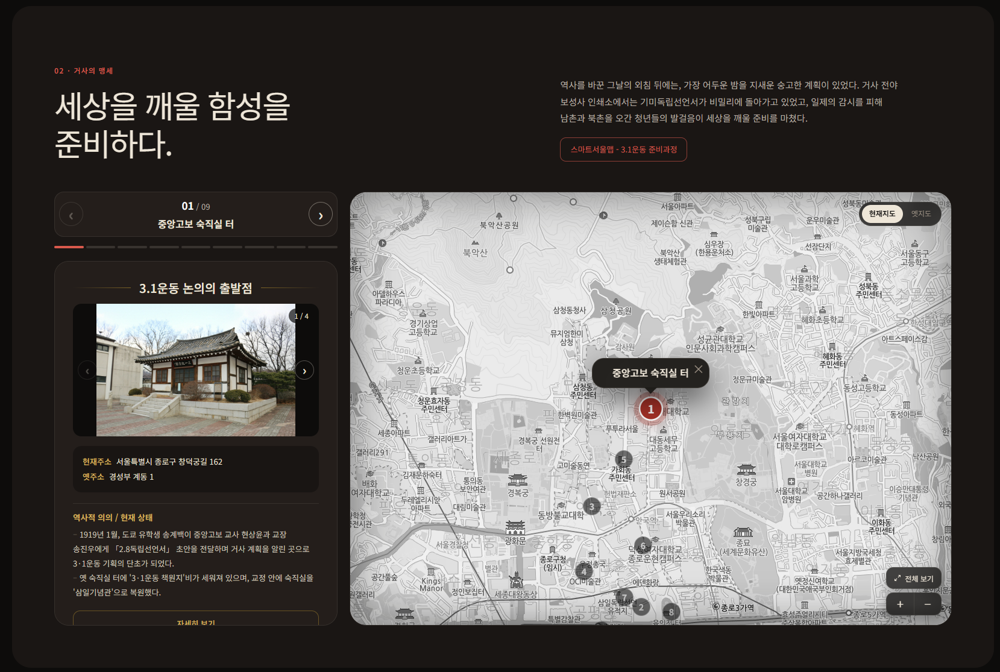
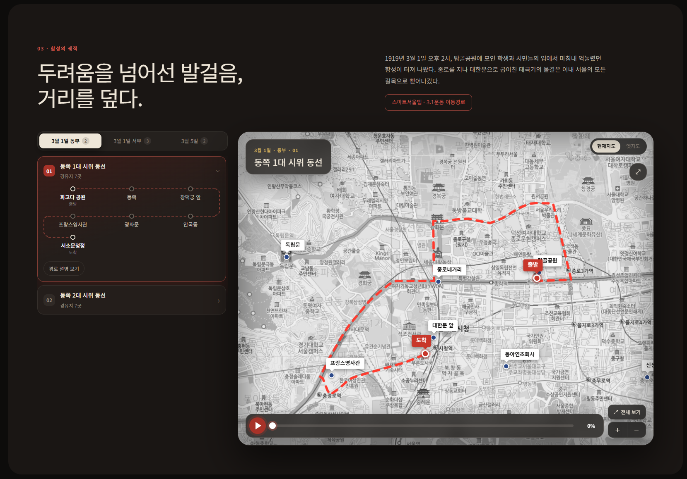
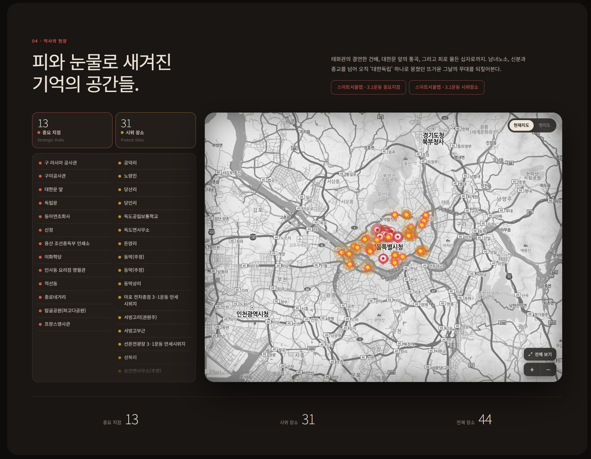
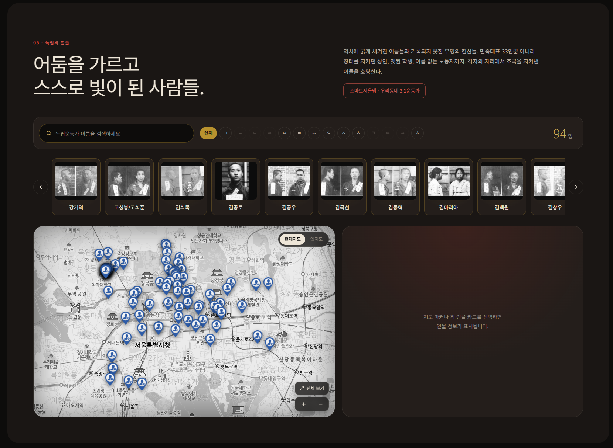
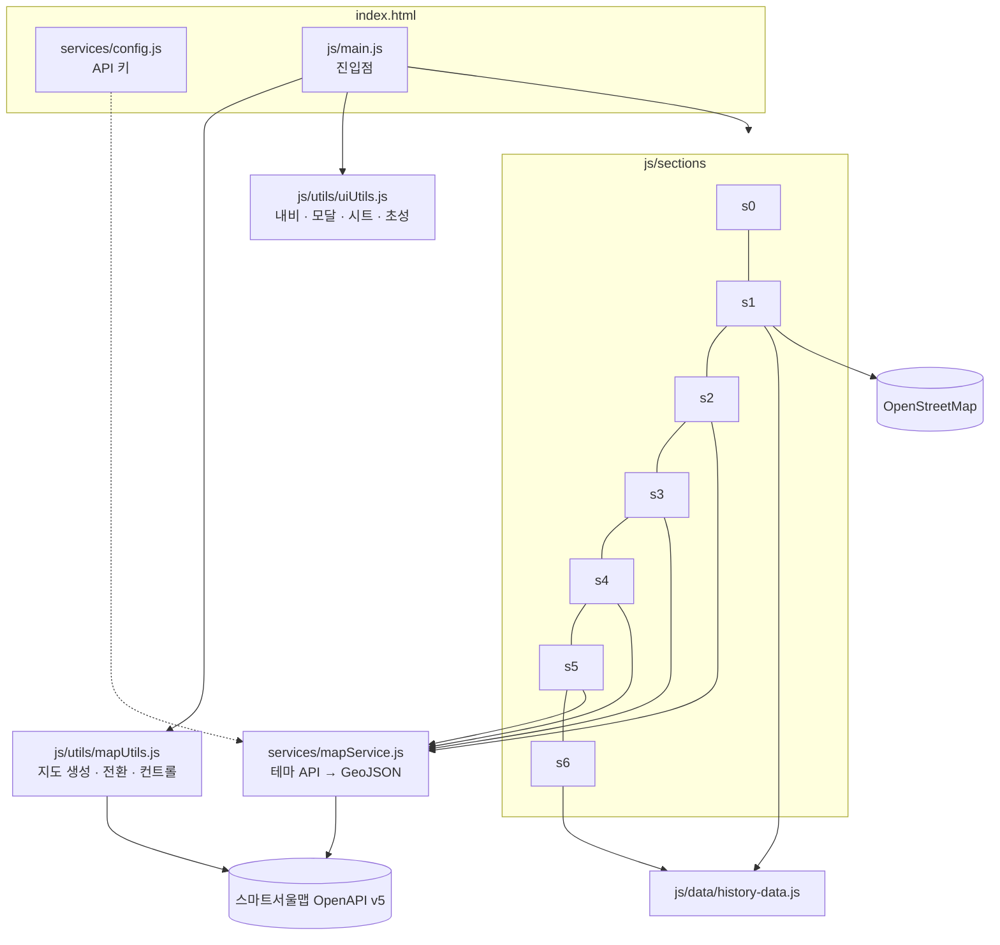

<div align="center">

# 서울 히스토리맵, 1919년 3월 그날의 발자취

**스마트서울맵 OpenAPI와 Leaflet으로 1919년 3·1운동의 거점, 시위 경로, 장소, 인물을 공간데이터로 구현한 웹 스토리맵**

[](https://march-first-storypage.vercel.app)


<details>
<summary>전체 페이지 보기</summary>

</details>

</div>

---

## 목차

1. [프로젝트 개요](#1-프로젝트-개요)
2. [화면 구성](#2-화면-구성)
3. [기술 스택](#3-기술-스택)
4. [시스템 구조](#4-시스템-구조)
5. [데이터](#5-데이터)
6. [주요 구현](#6-주요-구현)
7. [예외 처리 및 보정 로직](#7-예외-처리-및-보정-로직)
8. [실행 및 배포](#8-실행-및-배포)
9. [폴더 구조](#9-폴더-구조)
10. [출처 및 저작권](#10-출처-및-저작권)

---

## 1. 프로젝트 개요

| 항목       | 내용                                                                         |
| ---------- | ---------------------------------------------------------------------------- |
| 프로젝트명 | 서울 히스토리맵, 1919년 3월 그날의 발자취 (3·1운동 스토리맵)                 |
| 추진       | 서울특별시 디지털도시국 공간정보과 AI활용 공간정보구축사업 (서울 매력일자리) |
| 개발       | 이진우 (1인 기획 · 개발 · 데이터 가공)                                       |
| 자료 협력  | 서울시 공간정보과, 서울역사편찬원                                            |
| 배포       | https://march-first-storypage.vercel.app                                     |
| 형태       | 스크롤 기반 원페이지 스토리맵, PC · 모바일 단일 반응형                       |

### 제작 목적

- 스마트서울맵 테마 데이터와 서울역사편찬원 사료를 결합하여 3·1운동의 공간적 흐름을 지도 위에 재구성
- 텍스트 중심 사료를 장소 · 경로 · 인물 단위 공간데이터로 가공하여 시민 접근성 확보
- 스마트서울맵 OpenAPI 활용 사례 제작 (테마 데이터 조회, 상세 API, 옛지도 WMS)

### 이야기 흐름


---

## 2. 화면 구성

| 섹션 | 제목        | 핵심 기능                                                          | 데이터                         |
| ---- | ----------- | ------------------------------------------------------------------ | ------------------------------ |
| 00   | 인트로      | 기미독립선언서 배경, 선언서 원본 전체 화면 모달, 수치 띠           | 정적 이미지, API 결과 집계     |
| 01   | 시대의 부름 | 배경 사건 카드 4종 + 세계지도, 서울 지점 선택 시 스마트서울맵 전환 | history-data.js, OpenStreetMap |
| 02   | 거사의 맹세 | 거점 스테퍼 · 상세 카드(사진 슬라이드), 곡선 연결선                | 테마 11100550 거점             |
| 03   | 함성의 궤적 | 구분 탭 · 경로 카드 · 경유지 타임라인 · 경로 재생                  | 테마 11100550 경로             |
| 04   | 역사의 현장 | 중요 지점 · 시위 장소 필터, 가나다순 목록, 상세 팝업               | 테마 11100550 장소             |
| 05   | 독립의 별들 | 이름 검색 · 초성 필터, 인물 카드 · 지도 · 프로필                   | 테마 100173 인물               |
| 06   | 남겨진 유산 | 헌법 전문 인용, 역사적 의의 3종 펼침 목록                          | history-data.js                |

| 00 인트로                                                       | 01 시대의 부름                                                          |
| --------------------------------------------------------------- | ----------------------------------------------------------------------- |
|           |         |
| **02 거사의 맹세**                                              | **03 함성의 궤적**                                                      |
|            |             |
| **04 역사의 현장**                                              | **05 독립의 별들**                                                      |
|  |  |
| **06 남겨진 유산**                                              | **엔딩 · 푸터**                                                         |
|          |              |

---

## 3. 기술 스택

| 구분            | 기술                                                       | 용도                                   |
| --------------- | ---------------------------------------------------------- | -------------------------------------- |
| 마크업 · 스타일 | HTML5, CSS3 (CSS 변수, Grid, Flex, 미디어쿼리)             | 화면 구성, 디자인 토큰, 반응형         |
| 스크립트        | Vanilla JavaScript ES Module                               | 섹션별 모듈, 빌드 도구 미사용          |
| 지도 엔진       | Leaflet 1.9.4, Proj4Leaflet                                | 마커 · 경로선 · 팝업, EPSG:5179 좌표계 |
| 기본지도        | 스마트서울맵 OpenAPI v5 한글 일반지도 (DAWULGIS_EX)        | 섹션 2~5 현재지도                      |
| 옛지도          | 스마트서울맵 WMS (경성대지도, 근세 한국 오만분지일 지형도) | 현재지도 / 옛지도 전환                 |
| 세계지도        | OpenStreetMap                                              | 섹션 1 해외 지점                       |
| 데이터 API      | 스마트서울맵 테마 콘텐츠 목록 · 상세 API                   | 거점 · 경로 · 장소 · 인물              |
| 배포            | Vercel                                                     | 정적 호스팅, API 키 환경 변수          |

---

## 4. 시스템 구조



- 1단계: 지도 불필요 영역(인트로 · 섹션 1 · 6 · 공용 UI) 즉시 초기화
- 2단계: 스마트서울맵 스크립트 로드 후 지도 섹션(2~5) 초기화, 섹션별 try/catch
- IntersectionObserver로 화면 진입 시 지도 크기 재계산 · 마커 순차 표시

---

## 5. 데이터

### 5-1. 스마트서울맵 테마

| 테마 ID  | 테마명               | 사용 섹션    | 하위 분류                                                                      |
| -------- | -------------------- | ------------ | ------------------------------------------------------------------------------ |
| 11100550 | 3·1운동 시간여행     | 02 · 03 · 04 | 거점(`start_번호`), 경로(LineString), 시위 장소(SUB_ID 3), 중요 지점(SUB_ID 4) |
| 100173   | 3·1운동 생활 속 현장 | 05           | 독립운동가(SUB_ID 5)                                                           |

### 5-2. 주요 속성 필드

| 필드                                 | 의미                                               |
| ------------------------------------ | -------------------------------------------------- |
| `COT_CONTS_ID`                       | 콘텐츠 고유 ID (거점 순번, 경로 조회, 상세 API 키) |
| `COT_CONTS_NAME`                     | 콘텐츠명                                           |
| `COT_THEME_SUB_ID`                   | 하위 분류 (중요 지점 4 · 시위 장소 3 · 인물 5)     |
| `COT_COORD_X` / `COT_COORD_Y`        | 경도 / 위도 (WGS84)                                |
| `COT_COORD_DATA`                     | 경로 좌표 배열                                     |
| `COT_NAME_01~15` / `COT_VALUE_01~15` | 상세 항목명 / 내용                                 |

### 5-3. 데이터 가공 흐름


### 5-4. 좌표계

| 좌표계                          | EPSG | 사용 위치                                     |
| ------------------------------- | ---- | --------------------------------------------- |
| WGS84 경위도                    | 4326 | API 좌표값, Leaflet `LatLng`                  |
| Korea 2000 / Unified CS (UTM-K) | 5179 | 스마트서울맵 기본지도 · 옛지도 (`getCrsEx()`) |
| Web Mercator                    | 3857 | 섹션 1 OpenStreetMap                          |

- GeoJSON `[경도, 위도]` ↔ Leaflet `[위도, 경도]` 순서 변환

---

## 6. 주요 구현

### 섹션 1 시대의 부름

- 카드 · 마커 클릭 시 해당 위치 확대 · 강조
- 서울 지점 선택 또는 서울 범위 확대 시 OSM → 스마트서울맵 전환, 축소 시 세계지도 복귀

### 섹션 2 거사의 맹세

- `COT_CONTS_ID`가 `start_번호`인 콘텐츠 번호순 정렬 (거점 추가 시 자동 반영)
- 거점 연결선: 투영 좌표 2차 베지어 곡선, 구간별 휨 값으로 선 교차 · 마커 통과 회피

```js
// 두 점 중점에서 진행 방향 수직으로 bend 비율만큼 이동한 제어점 기준 2차 베지어
const p0 = map.project(from, 0);
const p2 = map.project(to, 0);
const d = p2.subtract(p0);
const c = p0
    .add(p2)
    .divideBy(2)
    .add(L.point(-d.y * bend, d.x * bend));
```

### 섹션 3 함성의 궤적

- 경로 7종 구분 탭(3월 1일 동부 · 서부 · 3월 5일), 콘텐츠 ID 기준 조회
- 경로 재생: 누적 거리 기반 선형 보간, `requestAnimationFrame` 프레임 간격 기준 진행
- 7개 경로 공통 축척: 정수 줌 + 남는 배율 CSS `transform` 분리 (EPSG:5179 타일 정수 줌만 제공)

```js
const zoom = Math.round(target); // 지도에 적용할 정수 줌
const scale = 2 ** (target - zoom); // 남는 배율 → CSS transform
mapEl.style.transform = `scale(${scale})`;
mapEl.style.width = `${100 / scale}%`;
mapEl.style.height = `${100 / scale}%`;
```

### 섹션 4 역사의 현장

- 중요 지점(빨간 핀) · 시위 장소(노란 핀) 필터, 가나다순 2열 목록
- 팝업 상세 항목: `COT_NAME_01~15` · `COT_VALUE_01~15` 자동 구성

### 섹션 5 독립의 별들

- 이름 검색 + 초성 필터 → 카드 · 마커 동시 필터링
- 프로필 상세 API 1회 호출 후 캐시

```js
// 한글 음절 = 0xAC00 + (초성 × 21 + 중성) × 28 + 종성 → 초성 = (code - 44032) / 588
const cho = consonants[Math.floor((code - 44032) / 588)];
```

---

## 7. 예외 처리 및 보정 로직

| 문제                        | 원인                                                        | 처리                                                                           |
| --------------------------- | ----------------------------------------------------------- | ------------------------------------------------------------------------------ |
| 소수 줌에서 기본지도 미표시 | `L.Proj.CRS`(EPSG:5179) 해상도 배열이 정수 줌 단위로만 정의 | `zoomSnap: 1`, 남는 배율 CSS `transform` 분리                                  |
| 줌 애니메이션 중 검은 화면  | 다단계 줌 전환 중 다음 줌 타일 미수신                       | 줌 변경 시 `setView(..., { animate: false })`, 같은 줌 이동만 애니메이션       |
| 팝업 열림 중 회색 화면      | 지도 이동 애니메이션 중 팝업 `autoPan` 중복 실행            | `moveend` 이후 팝업 열기                                                       |
| 경로 일부 미표시            | 테마 콘텐츠 미사용 설정 시 목록 순번(RNUM) 재부여           | `COT_CONTS_ID` 기준 조회                                                       |
| 메인 스크립트 500 응답      | 스마트서울맵 `/public/map/js/5.0` 서버 오류                 | proj4 · Proj4Leaflet 직접 로드 후 좌표계 스크립트(5179) 계속 로드              |
| 옛지도 축척 차이            | WMS 옛지도와 기본지도의 표현 범위 차이                      | 옛지도 전환 시 줌 보정 (섹션 2 고정 줌, 섹션 4 확대 줌 1단계 축소)             |
| 이미지 404 · http 차단      | 사료 경로 오류, https 페이지 혼합 콘텐츠 차단               | `onerror` 시 사진 영역 숨김, `toSafeImageUrl` https 프록시 변환                |
| 숨김 상태 지도 크기 0       | 화면 밖 · `display: none` 상태에서 지도 초기화              | IntersectionObserver 진입 시 `invalidateSize`, ResizeObserver 크기 변경 감지   |
| API 실패                    | 네트워크 · 서버 오류                                        | 빈 FeatureCollection 반환, 상세 API 실패 시 목록 속성만 사용, 섹션별 try/catch |

### 7-1. 소수 줌 기본지도 미표시

- 현상: `fitBounds` 결과가 10.5 등 소수 줌일 때 기본지도 타일 미표시
- 원인: 스마트서울맵 EPSG:5179 타일은 정수 줌 해상도만 제공, 소수 줌 해상도에 대응하는 타일 없음
- 처리: 지도는 정수 줌 고정, 목표 줌과의 차이는 CSS 배율로 표시

```js
const zoom = Math.round(target); // 지도에 적용할 정수 줌
const scale = 2 ** (target - zoom); // 남는 배율 → CSS transform
mapEl.style.transform = `scale(${scale})`;
mapEl.style.width = `${100 / scale}%`;
mapEl.style.height = `${100 / scale}%`;
map.invalidateSize({ animate: false });
```

- 마커 · 라벨 크기 유지: `scale: calc(1 / var(--map-scale))` 역배율 적용

### 7-2. 경로 일부 미표시

- 현상: 스마트서울맵 관리 화면에서 일부 콘텐츠 사용 여부 변경 후 다른 경로가 사라짐
- 원인: 목록 API 순번(RNUM)이 사용 콘텐츠 기준으로 재부여 → 순번 기반 조회 대상 변경
- 처리: 변경되지 않는 콘텐츠 ID로 조회

```js
const findFeature = (id) => geojson.features.find((f) => String(f.id) === id || String(f.properties.COT_CONTS_ID) === id);
```

### 7-3. 팝업 열림 중 회색 화면

- 현상: 장소 선택 시 지도가 회색으로 비고 타일이 늦게 표시
- 원인: `setView` 이동 애니메이션과 팝업 `autoPan` 이동이 동시에 실행되어 타일 요청 취소 · 재요청 반복
- 처리: 이동 완료(`moveend`) 후 팝업 열기, 이동이 없는 경우 대비 대기 시간 설정

```js
const point = map.project(place.latlng, zoom);
point.y -= Math.min(120, mapEl.clientHeight * 0.1); // 팝업 공간 확보
map.once("moveend", () => marker.openPopup());
map.setView(map.unproject(point, zoom), zoom, { animate: false });
```

### 7-4. 숨김 상태 지도 크기 0

- 현상: 스크롤로 섹션 진입 시 지도 일부만 표시되거나 회색 영역 발생
- 원인: Leaflet은 초기화 시점의 컨테이너 크기로 타일 범위 계산, 화면 밖 · 숨김 상태에서는 크기 0으로 계산
- 처리: 화면 진입 · 크기 변경 시 크기 재계산

```js
new IntersectionObserver((entries) => {
    if (entries[0].isIntersecting) map.invalidateSize();
}).observe(mapEl);
new ResizeObserver(() => map.invalidateSize()).observe(mapEl);
```

### 7-5. 줌 애니메이션 중 검은 화면

- 현상: 확대 · 축소 시 전환 중 지도 영역이 검게 표시
- 원인: 여러 단계 줌 애니메이션 중 중간 줌 타일을 요청하지만 수신 전에 다음 단계로 넘어감, 표시할 타일이 없는 구간 발생
- 처리: 줌이 바뀌는 이동은 애니메이션 없이 즉시 전환, 같은 줌 안의 이동만 애니메이션 적용

```js
const sameZoom = map.getZoom() === zoom;
map.setView(latlng, zoom, { animate: sameZoom });
```

### 7-6. 메인 스크립트 500 응답

- 현상: 스마트서울맵 서버 오류 시 지도 섹션 전체 미표시
- 원인: 메인 스크립트(`/public/map/js/5.0`)가 proj4 · Proj4Leaflet을 함께 로드, 실패 시 좌표계 스크립트(`getCrsEx`) 실행 불가
- 처리: 메인 스크립트 로드 실패 시 proj4 · Proj4Leaflet 직접 로드 후 좌표계 스크립트(5179) 계속 로드, 최종 실패 시 지도 영역 오류 문구 표시
- 오류 문구에 스크립트 주소 대신 이름(label) 표시 → API 키 콘솔 노출 방지

### 7-7. 옛지도 축척 차이

- 현상: 현재지도 → 옛지도 전환 시 같은 줌에서 옛지도가 확대되어 보이거나 범위가 맞지 않음
- 원인: 경성대지도 · 근세 지형도 WMS 원본의 제작 축척과 기본지도 표현 범위 차이
- 처리: 옛지도 전환 시 줌 보정
    - 섹션 2: 옛지도 표시 중 고정 줌(9.5) 적용
    - 섹션 4: 옛지도 표시 중 장소 확대 줌 1단계 축소

### 7-8. 이미지 404 · http 차단

- 현상: 사료 사진 자리에 깨진 이미지 아이콘 표시, 일부 사진 미표시
- 원인: 테마 데이터의 이미지 경로 오류(404), http 이미지 주소의 https 페이지 혼합 콘텐츠 차단
- 처리
    - `toSafeImageUrl`: 상대 주소 → 스마트서울맵 절대 주소, http 주소 → https 프록시(images.weserv.nl) 경유
    - 로드 실패(`onerror`) 시 사진 영역 숨김, 사진 슬라이드 목록에서 제외

### 7-9. API 실패

- 현상: 테마 API 응답 오류 시 섹션 초기화 중단, 이후 섹션까지 미표시
- 원인: 한 섹션의 예외가 진입점(`main.js`) 초기화 흐름 전체로 전파
- 처리
    - 목록 API 실패: 빈 FeatureCollection 반환 → 빈 목록 상태로 렌더링 계속
    - 상세 API 실패: 목록 속성만으로 카드 · 팝업 구성
    - 섹션별 try/catch: 한 섹션 오류가 다른 섹션 초기화에 영향 없음

```js
for (const init of [initPledge, initRoutes, initPlaces, initActivists]) {
    try {
        await init();
    } catch (e) {
        console.error(e);
    }
}
```

---

## 8. 실행 및 배포

### API 키

`services/config.js` 생성 (`.gitignore` 대상)

```js
const CONFIG = { MAP_API_KEY: "지도 API 키", THEMA_API_KEY: "테마 API 키" };
```

### 로컬 실행

ES Module · 루트 기준 절대경로 사용으로 파일 직접 열기(`file://`) 불가, 로컬 서버에서 실행

- VS Code Live Server: `index.html` → Open with Live Server
- 또는 `npx serve .`

### Vercel 배포

1. 환경 변수 `MAP_API_KEY`, `THEMA_API_KEY` 등록
2. 빌드 시 `scripts/write-config.mjs`가 `services/config.js` 생성, 누락 시 빌드 중단

---

## 9. 폴더 구조

```
.
├── index.html                  # 단일 페이지 마크업
├── vercel.json                 # 빌드 명령 · 출력 폴더
├── scripts/write-config.mjs    # 환경 변수 → services/config.js
├── services/
│   ├── config.js               # API 키 (.gitignore)
│   └── mapService.js           # 테마 API, GeoJSON 변환
├── js/
│   ├── main.js                 # 진입점, 2단계 초기화
│   ├── data/history-data.js    # 섹션 1 · 6 정적 콘텐츠
│   ├── sections/               # s0-hero.js ~ s6-legacy.js
│   └── utils/                  # mapUtils.js, uiUtils.js
├── css/
│   ├── tokens.css              # 디자인 토큰
│   ├── base.css                # 공통 요소 · 지도 컨트롤
│   ├── layout.css              # 내비 · 수치 띠 · 푸터
│   └── sections/               # s0-hero.css ~ s6-legacy.css
├── assets/images/              # 사료 · 마커 이미지
└── docs/images/                # README 스크린샷
```

---

## 10. 출처 및 저작권

- 지도: 스마트서울맵 OpenAPI (서울 지도, 경성대지도, 근세 한국 오만분지일 지형도), © OpenStreetMap contributors
- 스마트서울맵 테마 [3·1운동 시간여행], [3·1운동 생활 속 현장]
- 서울역사편찬원 『1919년 3월 1일 그날을 걷다』
- 서울역사박물관 [『경성과 평양의 3·1운동』]
- 우리역사넷, 한국근대사료DB, 한국민족문화대백과사전

본 사이트는 서울특별시 디지털도시국 공간정보과 AI활용 공간정보구축사업(서울 매력일자리)의 일환으로 추진되었습니다.

copyright © 2026. Seoul Metropolitan Government all rights reserved.
